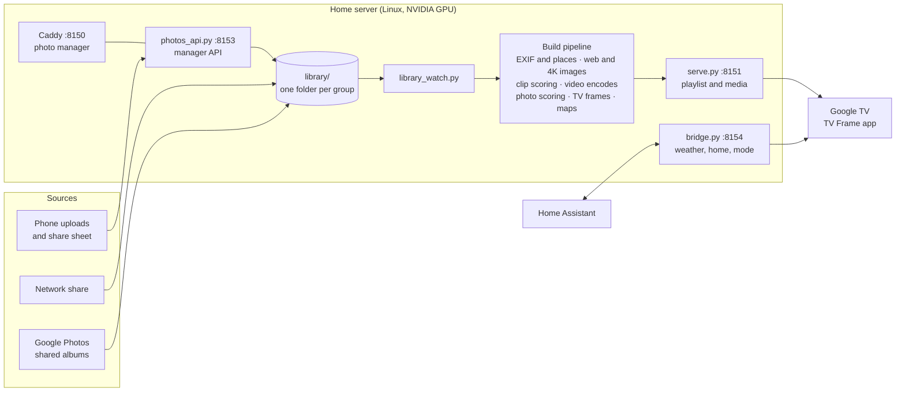

<h1 align="center">TV Frame</h1>

<p align="center">
  <b>Your own photos and clips on the living room TV, in true 4K, with the time, the weather and the house at a glance.</b><br>
  An Android TV screensaver and home screen, a small home server that prepares the photos, and a web page to run it all from your phone.
</p>

<p align="center">
  
</p>

<p align="center">
  <a href="#what-it-does">What it does</a> ·
  <a href="#how-it-fits-together">How it fits together</a> ·
  <a href="#setup">Setup</a> ·
  <a href="#day-to-day">Day to day</a> ·
  <a href="#repository-layout">Layout</a>
</p>

---

## What it does

**On the TV**

- **Glance.** When the TV sits idle, it fills with your photos, one a minute, with a soft fade between them. Along the bottom: the clock, today's weather, a Home tile (inside temperature and humidity, laundry while it runs) and one rotating tile: golden hour, air quality, a headline, or a photo from this week some years ago.
- **Real 4K.** Google TV draws its interface at 1080p. TV Frame plays each photo as a still frame on the video plane instead, so the picture itself is a full 3840 x 2160 while the text stays crisp on top.
- **Clips that never get cut off.** Short videos mix in with the photos. Each one starts on its best moment, plays two or three times on a seamless loop (no jump at the seam), and always finishes its last play before the next slide.
- **Details on demand.** Press OK on the remote to see where and when a photo was taken, the camera and lens, the exposure, and a satellite map of the spot.
- **A quiet home screen.** An optional replacement for the Google TV home: your apps on a photo backdrop, now-playing music from your speakers, and no ads. The stock home stays one click away, and casting, voice and the remote's app buttons keep working.
- **Survives updates.** A watchdog checks the TV every five minutes and puts the screensaver and home screen back if a system update reset them, then sends you a plain notification saying what it fixed.

**On your phone or laptop**

- **Folders, not albums to manage.** Each folder on the server is a group of photos. Add photos from the web page, an iPhone share sheet shortcut, a network share, or a Google Photos shared album. The server notices new files and rebuilds on its own.
- **Ranking you can see.** Every photo gets a score for how good it looks, how sharp, how well exposed and how clean, with faces in focus as a bonus. Near-duplicates are grouped so only the best of a burst shows. The ranking pages show every number, with filters and search.
- **Control what plays.** Hide a photo or a whole folder, show some photos more often, set how many clips mix in, or give a folder a season (holiday photos only in December). The Now on TV card lets you skip, go back, favorite or hide whatever is on screen right now.

<table>
  <tr>
    <td width="50%"></td>
    <td width="50%"></td>
  </tr>
  <tr>
    <td></td>
    <td></td>
  </tr>
</table>

### The photo manager

<picture>
  <source media="(prefers-color-scheme: dark)" srcset="docs/screenshots/manager-home-dark.png">
  
</picture>

<picture>
  <source media="(prefers-color-scheme: dark)" srcset="docs/screenshots/manager-rank-dark.png">
  
</picture>

<table>
  <tr>
    <td width="60%">
      <picture>
        <source media="(prefers-color-scheme: dark)" srcset="docs/screenshots/manager-folder-dark.png">
        
      </picture>
    </td>
    <td width="40%">
      <picture>
        <source media="(prefers-color-scheme: dark)" srcset="docs/screenshots/phone-dark.png">
        
      </picture>
    </td>
  </tr>
</table>

<sub>All screenshots use stock landscape photos from <a href="https://unsplash.com">Unsplash</a> and made-up weather, made with the tools in <code>tools/screenshots/</code>.</sub>

## How it fits together



- **The TV app** (`android/`) is a Kotlin Android TV app with no dependencies beyond the platform. It runs as the screensaver (a `DreamService`), as an on-demand show, and as the optional home screen. It keeps an offline copy of the stills, so the frame keeps going if the server is down.
- **The server** (`server/`, `tools/`) is plain Python, mostly standard library, run as `systemd --user` services. The heavier steps run in containers: image conversion with Pillow and HEIF support, and scoring on the GPU with [OpenCLIP](https://github.com/mlfoundations/open_clip) ViT-L/14, the LAION aesthetic predictor and the OpenCV YuNet face detector. Videos and TV frames are encoded with NVENC.
- **The bridge** is the only thing that talks to Home Assistant. The TV asks the bridge, so the Home Assistant token never leaves the server.
- **The photo manager** (`site/index.html`) is a single page with no build step, served read-only by Caddy.

### A few details worth knowing

- **Why stills are video.** Android TV composites its UI at 1080p, so a normal `ImageView` can never show more than 1080p. Each photo is also encoded as a one-frame HEVC Main 10 video and played on a `SurfaceView`, which the display hardware scales and shows at the panel's native 4K. The screen's text, tiles and fades are drawn on the UI plane above it.
- **Why fades use a veil.** The TV's display hardware does not blend two video layers, so a cross-fade between two video planes turns into a hard cut. Fades go through a brief veil on the UI plane instead, with the next photo's still underneath.
- **Readable text on bright photos.** Bright frames get a graduated shade baked in (like an ND grad filter) under the clock and caption, so white text stays readable without a dark bar.
- **What counts as a duplicate.** Photos taken close together that look alike to the image model are grouped, and only the best of each group goes on the TV. You can pick a different one from the Duplicates page.

## Setup

TV Frame was built for one home: a Google TV Streamer and a Linux box with an NVIDIA GPU on the same network. It should work on other Google TV and Android TV devices (Android 12 or later) and on any Linux server with an NVIDIA card, but those are untested. The scripts expect the repository at `~/tvframe`.

### 1. Server

Requirements: Python 3.12, Docker with the NVIDIA container runtime, `ffmpeg` with NVENC, `exiftool`, and Node 18 or later (only for the screenshot tools).

```bash
git clone https://github.com/nicglazkov/tvframe ~/tvframe
cd ~/tvframe

# settings for this home
mkdir -p ~/.config/tvframe
cp config.example.env ~/.config/tvframe/config.env && chmod 600 ~/.config/tvframe/config.env
$EDITOR ~/.config/tvframe/config.env

# containers for image conversion and scoring
docker build -t tvframe-media:heif -f tools/Dockerfile.media tools
docker build -t tvframe-curate:local curate
```

Home Assistant is optional. To use it, put a long-lived access token in `~/.config/tvframe/ha_token` (chmod 600) and copy `home_entities.example.json` to `~/.config/tvframe/home_entities.json` with your own entity ids.

The scoring step needs two model files in `curate/models/` (the OpenCLIP weights download there on their own the first time):

```bash
mkdir -p curate/models && cd curate/models
curl -LO https://github.com/opencv/opencv_zoo/raw/main/models/face_detection_yunet/face_detection_yunet_2023mar.onnx
curl -LO "https://github.com/christophschuhmann/improved-aesthetic-predictor/raw/main/sac+logos+ava1-l14-linearMSE.pth"
cd ../..
```

### 2. Photos

Put photos and videos in folders under `~/tvframe/library/`, one folder per group, then build everything once:

```bash
mkdir -p ~/tvframe/library/Trips
cp ~/Pictures/trip/*.jpg ~/tvframe/library/Trips/
tools/library_sync.sh
```

The first build reads every file, so it takes a while. Later builds only redo what changed.

Shoot S-Log3 video on a Sony camera? Put Sony's S-Log3 (S-Gamut3.Cine) to Rec.709 LUT, as a 33-point `.cube` file, at `tools/slog3_709.cube` and ungraded clips get it applied. Without it they play as shot. To pull from Google Photos shared albums instead, see [`ingest/README.md`](ingest/README.md).

### 3. Services

```bash
cp deploy/systemd/tvframe-* ~/.config/systemd/user/
systemctl --user daemon-reload
systemctl --user enable --now tvframe-photos tvframe-tune tvframe-bridge tvframe-library tvframe-watchdog.timer
loginctl enable-linger "$USER"        # keep them running when you are logged out

docker compose -f deploy/site.compose.yml up -d     # the photo manager on :8150

# weather, air quality and headlines for Glance, every 20 minutes
( crontab -l; echo "*/20 * * * * python3 $HOME/tvframe/tools/fetch_live.py >> $HOME/tvframe/real/live.log 2>&1" ) | crontab -
```

Open `http://<server>:8150/` to see the photo manager.

### 4. The TV app

On the TV, turn on Developer options and Network debugging. Then, with the Android SDK and a JDK 17 on the server:

```bash
cd ~/tvframe/android
cat >> local.properties <<EOF
sdk.dir=$HOME/android/sdk
tvframe.server=http://192.168.1.20
EOF
tools/make-key.sh                  # once; keep android/keystore/ private and backed up
./gradlew assembleRelease

cd .. && tools/deploy.sh           # install, make it the screensaver, set the home screen
```

`tools/deploy.sh` writes down every TV setting before it changes it. `tools/rollback.sh` puts them all back, and `tools/rollback.sh --uninstall` removes the app as well.

`tvframe.server` is only the default. It can be changed later in the app's settings. Add `tvframe.tz=Area/City` if the TV's own time zone is wrong.

## Day to day

| To | Do this |
| --- | --- |
| Add photos | Drop them in a folder on the share, upload on the photo manager, or use the Send to TV shortcut from the share sheet (the manager's menu, Send photos from iPhone). The TV has them within about half an hour. |
| Hide something | Tap the hide button on Now on TV, or open the photo's menu on the manager and choose Hide from TV. |
| See a photo's details | Press OK on the remote. Press OK again, or wait, to close. |
| Change how many clips play | Move the Photos and clips slider on the manager's home page. |
| Show a folder only part of the year | Folder menu, then Schedule. |
| Check the build | The status dot at the top of the manager. Tap it for each step and the GPU load. |
| Undo everything on the TV | `tools/rollback.sh` |

## Repository layout

```
android/            the TV app (Kotlin, no third-party libraries)
server/             playlist server, manager API, bridge, playlist builder, settings loader
tools/              build steps, TV deploy and rollback, watchdog, live data, screenshot tools
curate/             photo scoring and duplicate grouping (runs in a GPU container)
site/index.html     the photo manager (one file, no build step)
ingest/             Google Photos shared album sync
caddy/, deploy/     web server config, systemd units, compose file
docs/screenshots/   the images in this README
```

Everything personal stays outside the repository: `~/.config/tvframe/` holds addresses, tokens and Home Assistant entities, and the photos, the library, generated media, scores and logs live in folders that git ignores.

## Screenshots

The images here come from an Android TV emulator and headless Chrome fed with stock photos, never from a real library:

```bash
cd server && python3 ../tools/screenshots/make_demo.py <folder of landscape JPEGs> ~/tvframe-demo ../tools/screenshots/captions.json
python3 ../tools/screenshots/demo_server.py ~/tvframe-demo          # stand-in server and bridge on 9151 and 9154
cd ../tools && npm install && node screenshots/manager_shots.js ~/tvframe-demo ../docs/screenshots
```

For the TV shots, build the app with `./gradlew assembleRelease -Ptvframe.server=http://127.0.0.1`, install it on an emulator, forward the ports with `adb reverse tcp:8151 tcp:9151` and `adb reverse tcp:8154 tcp:9154`, and capture with `adb exec-out screencap -p`.

## License

Not yet chosen. Until a license is added, all rights are reserved.
