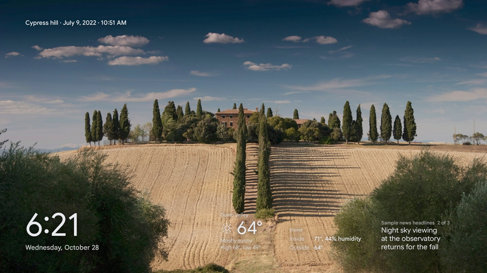
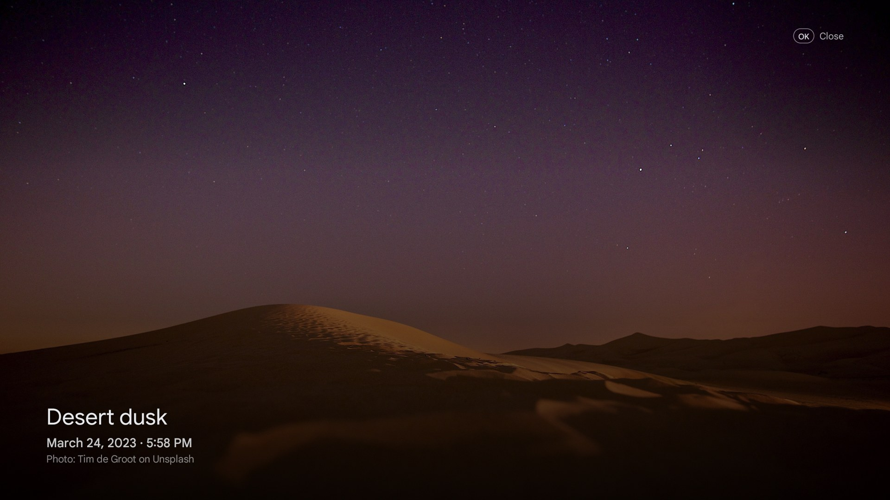
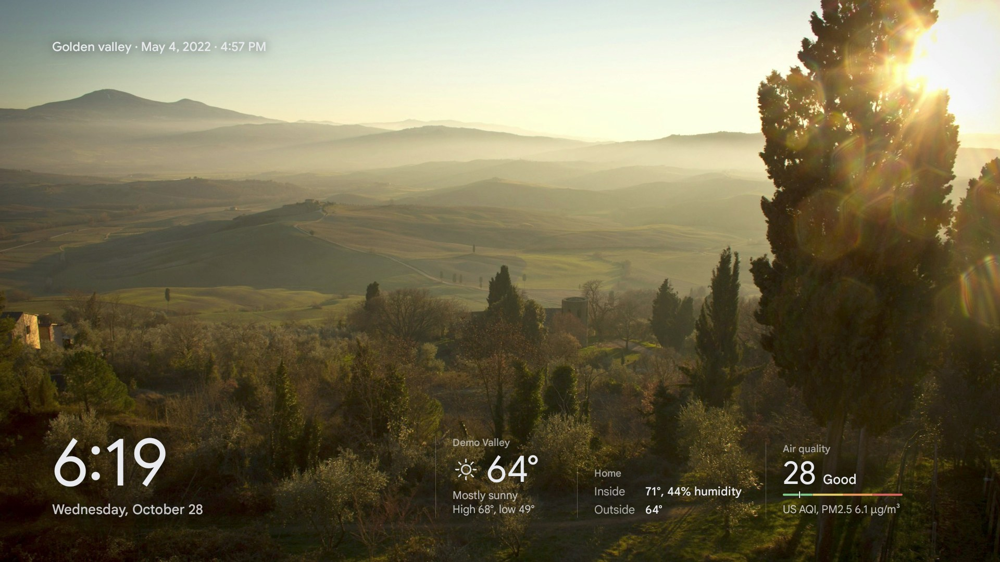
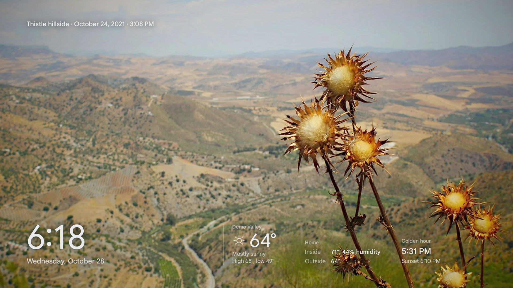
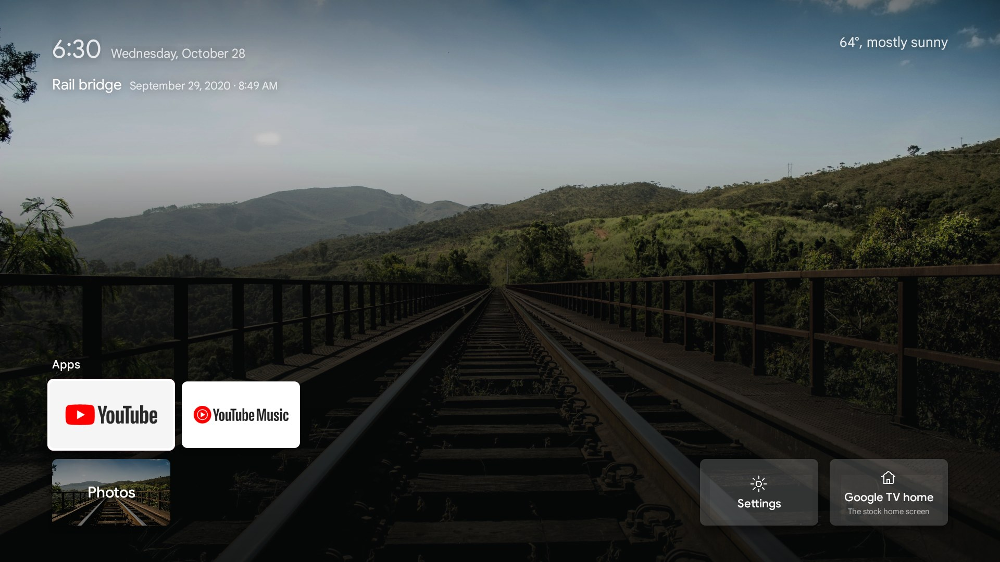

<h1 align="center">TV Frame</h1>

<p align="center">
  <b>Your own photos and clips on the living room TV, in true 4K, with the time, the weather and the house at a glance.</b><br>
  An Android TV screensaver and home screen, a small home server that prepares the photos, and a web page to run it all from your phone.
</p>

<p align="center">
  
</p>

<p align="center">
  <a href="#what-it-does">What it does</a> ·
  <a href="#how-it-fits-together">How it fits together</a> ·
  <a href="#install">Install</a> ·
  <a href="#day-to-day">Day to day</a> ·
  <a href="#repository-layout">Layout</a>
</p>

---

## What it does

**On the TV**

- **Glance.** When the TV sits idle, it fills with your photos, one a minute, with a soft fade between them. Along the bottom: the clock, today's weather, a Home tile (inside temperature and humidity, laundry while it runs) and one rotating tile: golden hour, air quality, a headline, or a photo from this week some years ago.
- **Real 4K.** Google TV draws its interface at 1080p. TV Frame plays each photo as a still frame on the video plane instead, so the picture itself is a full 3840 x 2160 while the text stays crisp on top.
- **Clips that never get cut off.** Short videos mix in with the photos. Each one starts on its best moment, plays two or three times on a seamless loop (no jump at the seam), and always finishes its last play before the next slide.
- **Details on demand.** Press OK on the remote to see where and when a photo was taken, the camera and lens, the exposure, and a satellite map of the spot.
- **A quiet home screen.** An optional replacement for the Google TV home: your apps on a photo backdrop, now-playing music from your speakers, and no ads. The stock home stays one click away, and casting, voice and the remote's app buttons keep working.
- **Survives updates.** A watchdog checks the TV every five minutes and puts the screensaver and home screen back if a system update reset them, then sends you a plain notification saying what it fixed.

**On your phone or laptop**

- **Folders, not albums to manage.** Each folder on the server is a group of photos. Add photos from the web page, an iPhone share sheet shortcut, a network share, or a Google Photos shared album. The server notices new files and rebuilds on its own.
- **Ranking you can see.** Every photo gets a score for how good it looks, how sharp, how well exposed and how clean, with faces in focus as a bonus. Near-duplicates are grouped so only the best of a burst shows. The ranking pages show every number, with filters and search.
- **Control what plays.** Hide a photo or a whole folder, show some photos more often, set how many clips mix in, or give a folder a season (holiday photos only in December). The Now on TV card lets you skip, go back, favorite or hide whatever is on screen right now.

<table>
  <tr>
    <td width="50%"></td>
    <td width="50%"></td>
  </tr>
  <tr>
    <td></td>
    <td></td>
  </tr>
</table>

### The photo manager

<picture>
  <source media="(prefers-color-scheme: dark)" srcset="docs/screenshots/manager-home-dark.png">
  
</picture>

<picture>
  <source media="(prefers-color-scheme: dark)" srcset="docs/screenshots/manager-rank-dark.png">
  
</picture>

<table>
  <tr>
    <td width="60%">
      <picture>
        <source media="(prefers-color-scheme: dark)" srcset="docs/screenshots/manager-folder-dark.png">
        
      </picture>
    </td>
    <td width="40%">
      <picture>
        <source media="(prefers-color-scheme: dark)" srcset="docs/screenshots/phone-dark.png">
        
      </picture>
    </td>
  </tr>
</table>

<sub>All screenshots use stock landscape photos from <a href="https://unsplash.com">Unsplash</a> and made-up weather, made with the tools in <code>tools/screenshots/</code>.</sub>

## How it fits together


- **The TV app** (`android/`) is a Kotlin Android TV app with no dependencies beyond the platform. It runs as the screensaver (a `DreamService`), as an on-demand show, and as the optional home screen. It keeps an offline copy of the stills, so the frame keeps going if the server is down.
- **The server** (`server/`, `tools/`) is plain Python, mostly standard library. It runs in one container (`Dockerfile`, `compose.yaml`) next to a Caddy container for the manager. Photos are scored with [OpenCLIP](https://github.com/mlfoundations/open_clip) ViT-L/14, the LAION aesthetic predictor and the OpenCV YuNet face detector, on the GPU when there is one. Videos and TV frames are encoded with NVENC on NVIDIA cards and with x265, x264 and SVT-AV1 on the CPU otherwise (`server/encoders.py`).
- **The bridge** is the only thing that talks to Home Assistant. The TV asks the bridge, so the Home Assistant token never leaves the server.
- **The photo manager** (`site/index.html`) is a single page with no build step, served read-only by Caddy.

### A few details worth knowing

- **Why stills are video.** Android TV composites its UI at 1080p, so a normal `ImageView` can never show more than 1080p. Each photo is also encoded as a one-frame HEVC Main 10 video and played on a `SurfaceView`, which the display hardware scales and shows at the panel's native 4K. The screen's text, tiles and fades are drawn on the UI plane above it.
- **Why fades use a veil.** The TV's display hardware does not blend two video layers, so a cross-fade between two video planes turns into a hard cut. Fades go through a brief veil on the UI plane instead, with the next photo's still underneath.
- **Readable text on bright photos.** Bright frames get a graduated shade baked in (like an ND grad filter) under the clock and caption, so white text stays readable without a dark bar.
- **What counts as a duplicate.** Photos taken close together that look alike to the image model are grouped, and only the best of each group goes on the TV. You can pick a different one from the Duplicates page.

## Install

You need two things on the same home network:

- **A TV that runs Google TV or Android TV 12 or later.** The Google TV Streamer is what it is built and tested on. See [Devices](docs/DEVICES.md) for the others.
- **A computer that stays on**, running Linux with Docker. An NVIDIA graphics card makes the photo builds fast; without one everything still works, only slower. 8 GB of memory and 25 GB of free disk is enough to start.

On that computer:

```bash
git clone https://github.com/nicglazkov/tvframe ~/tvframe
cd ~/tvframe
./tvframe setup
```

`setup` checks Docker and the graphics card (and offers to install what is missing), asks where your photos are, your town for the weather and your time zone, then builds and starts the server. It takes 10 to 20 minutes the first time, most of it downloading. When it finishes, open the photo manager it prints, `http://<this computer>:8150/`, on your phone.

Then put it on the TV:

```bash
./tvframe tv
```

It shows what to switch on in the TV's Developer options, connects to the TV, builds the app and installs it as the screensaver. Approve the debugging prompt on the TV when it appears. That is all: the TV shows your photos once the first build is done, and keeps up with the library from then on.

<details>
<summary>Other ways to install</summary>

- **One line:** `curl -fsSL https://raw.githubusercontent.com/nicglazkov/tvframe/main/install.sh | sh` clones into `~/tvframe` and runs `setup` (once the repository is public).
- **Without Docker:** the services as `systemd --user` units straight on a Linux server. See [docs/MANUAL.md](docs/MANUAL.md).
- **No questions:** `./tvframe setup --yes` takes every default; edit `~/.config/tvframe/config.env` afterwards and run `./tvframe restart`.

</details>

### Works with

| | Status |
| --- | --- |
| Google TV Streamer (4K) | Tested, runs every day |
| Google TV emulator (Android 14) | Tested |
| Chromecast with Google TV, onn 4K, other Google TV and Android TV 12+ devices | Expected to work, untested |
| Fire TV, Nvidia Shield, Roku, Apple TV, other smart TVs | Not supported |
| Server: Linux with an NVIDIA GPU | Tested |
| Server: Linux, CPU only (AMD and Intel graphics included) | Tested. Same results; builds with many 4K clips are much slower |
| Server: Windows (WSL 2) and macOS with Docker Desktop | Expected to work, untested |

The full table, with why each one is or is not supported: [docs/DEVICES.md](docs/DEVICES.md).

## Day to day

| To | Do this |
| --- | --- |
| Add photos | Drop folders into the photos folder you chose at setup, or upload on the photo manager. Each folder shows on the TV as a group. New photos reach the TV after the next build, usually within half an hour. |
| Hide something | Tap the hide button on Now on TV, or open the photo's menu on the manager and choose Hide from TV. |
| See a photo's details | Press OK on the remote. Press OK again, or wait, to close. |
| Change how many clips play | Move the Photos and clips slider on the manager's home page. |
| Show a folder only part of the year | Folder menu, then Schedule. |
| Check the build | The status dot at the top of the manager. Tap it for each step and the GPU load. Or `./tvframe status`. |
| See what the server is doing | `./tvframe logs` |
| Change a setting | Edit `~/.config/tvframe/config.env`, then `./tvframe restart`. [`config.example.env`](config.example.env) lists them all. |
| Update TV Frame | `./tvframe update` pulls the new version, rebuilds the server and updates the app on the TV. |
| Undo everything on the TV | `./tvframe tv remove` (add `--uninstall` to remove the app too) |
| Remove TV Frame | `./tvframe uninstall`. Your photos are left where they are. |

## Repository layout

```
tvframe             the command: setup, tv, status, logs, update, uninstall
install.sh          one-line installer (clones, then runs ./tvframe setup)
Dockerfile          the server image: Python, ffmpeg, adb and the scoring models
compose.yaml        the server and the photo manager's web server
android/            the TV app (Kotlin, no third-party libraries) and its build image
server/             playlist server, manager API, bridge, playlist builder, settings loader
tools/              build steps, TV deploy and rollback, watchdog, live data, screenshot tools
curate/             photo scoring and duplicate grouping
site/index.html     the photo manager (one file, no build step)
ingest/             Google Photos shared album sync
caddy/, deploy/     web server config, systemd units for running without Docker
docs/               devices, running without Docker, releasing, screenshots
.github/workflows/  checks on every push, signed app and images on every release
```

Everything personal stays outside the repository: `~/.config/tvframe/` holds addresses, tokens and Home Assistant entities, and the photos, the library, generated media, scores and logs live in folders that git ignores.

## Screenshots

The images here come from an Android TV emulator and headless Chrome fed with stock photos, never from a real library:

```bash
cd server && python3 ../tools/screenshots/make_demo.py <folder of landscape JPEGs> ~/tvframe-demo ../tools/screenshots/captions.json
python3 ../tools/screenshots/demo_server.py ~/tvframe-demo          # stand-in server and bridge on 9151 and 9154
cd ../tools && npm install && node screenshots/manager_shots.js ~/tvframe-demo ../docs/screenshots
```

For the TV shots, build the app with `./gradlew assembleRelease -Ptvframe.server=http://127.0.0.1`, install it on an emulator, forward the ports with `adb reverse tcp:8151 tcp:9151` and `adb reverse tcp:8154 tcp:9154`, and capture with `adb exec-out screencap -p`.

## License

Not yet chosen. Until a license is added, all rights are reserved.
