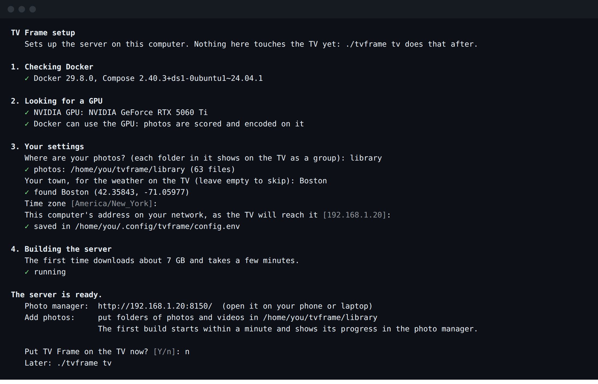

<h1 align="center">TV Frame</h1>

<p align="center">
  <b>Your own photos and clips on the living room TV, in true 4K, with the time, the weather and the house at a glance.</b><br>
  An Android TV screensaver and home screen, a small home server that prepares the photos, and a web page to run it all from your phone.
</p>

<p align="center">
  
</p>

<p align="center">
  <a href="#what-it-does">What it does</a> ·
  <a href="#install">Install</a> ·
  <a href="#using-it">Using it</a> ·
  <a href="#settings">Settings</a> ·
  <a href="#troubleshooting">Troubleshooting</a> ·
  <a href="#how-it-fits-together">How it works</a>
</p>

---

## What it does

**On the TV**

- **Glance.** When the TV sits idle, it fills with your photos, one a minute, with a soft fade between them. Along the bottom: the clock, today's weather, a Home tile (inside temperature and humidity, laundry while it runs) and one rotating tile: golden hour, air quality, a headline, or a photo from this week some years ago.
- **Real 4K.** Google TV draws its interface at 1080p. TV Frame plays each photo as a still frame on the video plane instead, so the picture itself is a full 3840 x 2160 while the text stays crisp on top.
- **Clips that never get cut off.** Short videos mix in with the photos. Each one starts on its best moment, plays two or three times on a seamless loop (no jump at the seam), and always finishes its last play, fading out on its final frame, before the next slide.
- **Details on demand.** Press OK on the remote to see where and when a photo was taken, the camera and lens, the exposure, and a satellite map of the spot.
- **A quiet home screen.** An optional replacement for the Google TV home: your apps on a photo backdrop, now-playing music from your speakers, and no ads. The stock home stays one click away, and casting, voice and the remote's app buttons keep working.
- **Survives updates.** A watchdog checks the TV every five minutes and puts the screensaver and home screen back if a system update reset them, then sends you a plain notification saying what it fixed.

**On your phone or laptop**

- **Folders, not albums to manage.** Each folder in your photos folder is a group on the TV. Add photos from the web page, an iPhone share sheet shortcut, a network share, or a Google Photos shared album. The server notices new files and rebuilds on its own. Photos and videos from phones and cameras work as they are: JPEG, HEIC, PNG, MP4 and MOV.
- **Ranking you can see.** Every photo gets a score for how good it looks, how sharp, how well exposed and how clean, with faces in focus as a bonus. Near-duplicates are grouped so only the best of a burst shows. The ranking pages show every number, with filters and search.
- **Fix things in bulk.** Select many photos or clips at once to hide, show or boost them. Hover over a clip to preview it. Trim the part of a clip the TV plays, and choose how each photo is framed on a 16:9 screen: filling it, whole on a blurred copy of itself, or cropped to the part you pick.
- **Control what plays.** Hide a photo or a whole folder, show some photos more often, set how many clips mix in, or give a folder a season (holiday photos only in December). The Now on TV card lets you skip, go back, favorite or hide whatever is on screen right now.

<table>
  <tr>
    <td width="50%"></td>
    <td width="50%"></td>
  </tr>
  <tr>
    <td></td>
    <td></td>
  </tr>
</table>

### The photo manager

<picture>
  <source media="(prefers-color-scheme: dark)" srcset="docs/screenshots/manager-home-dark.png">
  
</picture>

<table>
  <tr>
    <td width="50%">
      <picture>
        <source media="(prefers-color-scheme: dark)" srcset="docs/screenshots/manager-rank-dark.png">
        
      </picture>
      <p align="center"><sub>Photo ranking, three photos selected</sub></p>
    </td>
    <td width="50%">
      <picture>
        <source media="(prefers-color-scheme: dark)" srcset="docs/screenshots/manager-frame-dark.png">
        
      </picture>
      <p align="center"><sub>How a photo is framed on the TV</sub></p>
    </td>
  </tr>
  <tr>
    <td>
      <picture>
        <source media="(prefers-color-scheme: dark)" srcset="docs/screenshots/manager-clips-dark.png">
        
      </picture>
      <p align="center"><sub>Clip ranking, previewing a clip on hover</sub></p>
    </td>
    <td>
      <picture>
        <source media="(prefers-color-scheme: dark)" srcset="docs/screenshots/manager-trim-dark.png">
        
      </picture>
      <p align="center"><sub>Trimming the part of a clip the TV plays</sub></p>
    </td>
  </tr>
  <tr>
    <td>
      <picture>
        <source media="(prefers-color-scheme: dark)" srcset="docs/screenshots/manager-folder-dark.png">
        
      </picture>
      <p align="center"><sub>A folder</sub></p>
    </td>
    <td>
      <p align="center">
      <picture>
        <source media="(prefers-color-scheme: dark)" srcset="docs/screenshots/phone-dark.png">
        
      </picture>
      </p>
      <p align="center"><sub>On a phone</sub></p>
    </td>
  </tr>
</table>

<sub>All screenshots use stock landscape photos from <a href="https://unsplash.com">Unsplash</a>, clips from <a href="https://commons.wikimedia.org">Wikimedia Commons</a> (CC BY 3.0) and made-up dates and places. They come from a test install and an Android TV emulator, with the tools in <code>tools/screenshots/</code>.</sub>

## Install

You need two things on the same home network:

- **A TV that runs Google TV or Android TV 12 or later.** The Google TV Streamer is what TV Frame is built and tested on. [docs/DEVICES.md](docs/DEVICES.md) covers the others.
- **A computer that stays on**, running Linux with Docker. An NVIDIA graphics card makes builds fast; without one everything still works, only slower. 8 GB of memory and 25 GB of free disk is enough to start.

### 1. The server

On that computer:

```bash
git clone https://github.com/nicglazkov/tvframe ~/tvframe
cd ~/tvframe
./tvframe setup
```

<p align="center"></p>

`setup` goes through four steps and explains each one as it goes:

1. **Docker.** Checks it is installed and running. If it is missing, it offers to install it with Docker's own script.
2. **The graphics card.** If there is an NVIDIA card, it checks Docker can reach it, offers to install the NVIDIA Container Toolkit if not, and writes `compose.override.yaml` to hand the card to the server. No NVIDIA card: it picks the smaller CPU image and says so.
3. **A few questions.** Where your photos are (any folder; each folder inside it becomes a group on the TV), your town for the weather (looked up on Open-Meteo, no account), your time zone and this computer's address on your network. The answers go in `~/.config/tvframe/config.env`.
4. **The server.** Builds the server image (about 10 minutes the first time, mostly downloading PyTorch and the scoring models) and starts it with Docker Compose. It restarts on its own after a reboot.

When it is done it prints the photo manager's address, `http://<this computer>:8150/`. Open it on your phone. The first build of your library starts within a minute, and the manager shows its progress.

### 2. The TV

```bash
./tvframe tv
```

First, on the TV, once:

1. **Settings > System > About**, then select **Android TV OS build** seven times, until it says you are a developer.
2. **Settings > System > Developer options**, then turn on **USB debugging**.
3. Note the TV's address: **Settings > Network & Internet**, then your network.

`./tvframe tv` asks for that address and connects. The TV then asks **Allow USB debugging?**: tick **Always allow from this computer** and choose **Allow**. If the TV only offers **Wireless debugging** (some Android 14 devices), the command walks you through pairing with a code instead.

It then asks whether you want the quiet home screen, builds the app (in a container, about 3 minutes the first time) and installs it. Before it changes anything, it writes down the TV's own screensaver and home settings so `./tvframe tv remove` can put them back exactly.

That is all. The TV shows your photos once the first build finishes, and keeps up with the library from then on.

<details>
<summary>Other ways to install</summary>

- **One line:** `curl -fsSL https://raw.githubusercontent.com/nicglazkov/tvframe/main/install.sh | sh` clones into `~/tvframe` and runs `setup` (once the repository is public).
- **Without questions:** `./tvframe setup --yes` takes every suggested answer. Edit `~/.config/tvframe/config.env` afterwards and run `./tvframe restart`.
- **Without Docker:** the services as `systemd --user` units straight on a Linux server. See [docs/MANUAL.md](docs/MANUAL.md).

</details>

### Works with

| | Status |
| --- | --- |
| Google TV Streamer (4K) | Tested, runs every day |
| Google TV emulator (Android 14) | Tested |
| Chromecast with Google TV, onn 4K, other Google TV and Android TV 12+ devices | Expected to work, untested |
| Fire TV, Nvidia Shield, Roku, Apple TV, other smart TVs | Not supported |
| Server: Linux with an NVIDIA GPU | Tested |
| Server: Linux, CPU only (AMD and Intel graphics included) | Tested. Same results; builds with many 4K clips are much slower |
| Server: Windows (WSL 2) and macOS with Docker Desktop | Expected to work, untested |

The full table, with why each one is or is not supported: [docs/DEVICES.md](docs/DEVICES.md).

## Using it

### Day to day

| To | Do this |
| --- | --- |
| Add photos | Drop them into a folder inside your photos folder, or upload on the photo manager. A new folder is a new group on the TV. A build starts 45 seconds after the last file lands, and the TV picks up the result within 30 minutes. |
| Hide something | Tap the hide button on Now on TV, or open the photo's menu on the manager and choose Hide from TV. Hidden photos stay in your folder. |
| See more of something | Photo menu, then See more often, or the heart on Now on TV for a favorite. |
| See a photo's details | Press OK on the remote. Press OK again, or wait, to close. |
| Skip ahead or go back | The arrows on the manager's Now on TV card. |
| Change how many clips play | Move the Photos and clips slider on the manager's home page. |
| Show a folder only part of the year | Folder menu, then Schedule. |
| Check the build | The status dot at the top of the manager: tap it for each step and the GPU load. Or `./tvframe status`. |
| Rebuild now | `./tvframe rebuild` |
| See what the server is doing | `./tvframe logs` |
| Change a setting | Edit `~/.config/tvframe/config.env`, then `./tvframe restart`. See [Settings](#settings). |
| Update TV Frame | `./tvframe update`: pulls the new version, rebuilds the server and updates the app on the TV. |
| Undo everything on the TV | `./tvframe tv remove` (add `--uninstall` to remove the app too) |
| Remove TV Frame | `./tvframe uninstall`. Your photos and settings are left where they are. |

### On the TV

- **When it starts.** TV Frame is the TV's screensaver, so Glance comes up after 5 idle minutes. **OK** opens the details; any other button brings back what you were watching.
- **The details panel** for the photo on screen: where and when, camera and lens, exposure, and a small satellite map when the photo has a location. **OK** or **Back** closes it.
- **The quiet home screen** (if you chose it) opens on **Home**. Arrow keys move between apps, **OK** opens one. The Google TV home is still installed and comes back with `./tvframe tv remove`.
- **Offline.** The app keeps a copy of the stills on the TV. If the server is off, the frame keeps showing what it has.

### The photo manager, page by page

| Page | What it is for |
| --- | --- |
| **Home** | Now on TV (skip, go back, favorite, hide), the photos and clips slider, and your folders with how many of each are on the TV. |
| **A folder** | Every photo and clip in it with its state on the TV. Upload by dragging files onto the page. Rename, schedule or remove the folder from its menu. |
| **Everything** | All folders in one grid, with search. Hover to preview. |
| **Duplicates** | Groups of near-identical photos. The best one shows on the TV; pick another if you prefer. |
| **Photo ranking** | Every photo's score and what goes into it, sortable. Select many to hide, show or change how often they come up. Each photo's TV framing: fill the screen, whole on a blurred copy of itself, your own crop, or left to the TV. |
| **Clip ranking** | Every clip with what the scorer saw in it. Hover to preview, select many to include or leave out, and trim the part the TV plays. |

Changes on the manager reach the TV within seconds (hiding, favorites, skipping) or after the next build (framing, trims, new photos).

## Settings

Everything lives in `~/.config/tvframe/config.env`, written by `setup` and safe to edit. Run `./tvframe restart` after a change. [`config.example.env`](config.example.env) has every setting with a comment.

| Setting | What it does |
| --- | --- |
| `TVFRAME_HOST` | This computer's address on your network, as the TV and your phone reach it. |
| `TVFRAME_TV` | The TV's address for installing and the watchdog, such as `192.168.1.30:5555`. Set by `./tvframe tv`. |
| `TVFRAME_TZ` | Time zone for the clock, schedules and logs, such as `America/New_York`. |
| `LIVE_LAT`, `LIVE_LON`, `LIVE_PLACE` | Where the weather, air quality and sun times are for, and the name shown. Leave them out to turn the weather off. |
| `HOME_LAT`, `HOME_LON` | Photos further than about 40 km from here count as trips. Defaults to the weather location. |
| `TVFRAME_QUIET_HOME` | `1` for the quiet home screen, `0` to leave the Google TV home alone. Set by `./tvframe tv`. |
| `TVFRAME_ENCODER` | `auto` (the default: NVENC when it works, else the CPU), `nvenc` or `cpu`. |
| `HA_URL`, `HA_TOKEN_FILE`, `HA_ENTITIES`, `HA_NOTIFY` | Home Assistant, all optional. See below. |

Two more files sit next to the checkout and are written by `setup`: `.env` (the folders Docker mounts, your user id, which image to use) and, with an NVIDIA card, `compose.override.yaml`.

## Optional extras

- **Home Assistant.** Put a long-lived access token in `~/.config/tvframe/ha_token` (chmod 600), set `HA_URL`, and copy [`home_entities.example.json`](home_entities.example.json) to `~/.config/tvframe/home_entities.json` with your own entities. Glance then shows the inside temperature and humidity and the laundry while it runs, the quiet home screen shows what your speakers are playing, and the watchdog sends a phone notification when it had to fix the TV. The token never leaves the server: the TV only talks to TV Frame's bridge.
- **Google Photos shared albums.** [`ingest/README.md`](ingest/README.md) pulls shared albums into folders on a schedule.
- **iPhone uploads.** The manager's menu has Send photos from iPhone: a share sheet shortcut that uploads straight into a folder.
- **Sony S-Log3 video.** Put Sony's S-Log3 (S-Gamut3.Cine) to Rec.709 LUT, as a 33-point `.cube` file, at `tools/slog3_709.cube` and ungraded clips get it applied. Without it they play as shot.

## What leaves your network

TV Frame runs at home and needs no account. It reaches out to these free services, none of which get your photos:

| Service | For | Sent |
| --- | --- | --- |
| [Open-Meteo](https://open-meteo.com) | Weather, air quality, the town lookup during setup | The weather location |
| [NPR](https://www.npr.org) top stories RSS | The headline tile | Nothing |
| [OpenStreetMap](https://www.openstreetmap.org) Nominatim and Overpass | Place names for photos with a location | Each photo's location, rounded to about 100 m |
| [Esri World Imagery](https://www.arcgis.com/home/item.html?id=10df2279f9684e4a9f6a7f08febac2a9) | The small satellite maps in the details panel | The map area around each photo |

Photos without a location never cause a lookup. Results are cached, so each place is looked up once.

## Troubleshooting

| Problem | What to do |
| --- | --- |
| `./tvframe tv` cannot reach the TV | Check USB debugging is still on (some updates turn it off) and the address is right. Devices that use Wireless debugging get a new port after every restart: run `./tvframe tv` again and pair. |
| The TV asked to allow debugging and nothing happened | It waits two minutes. Run `./tvframe tv` again and choose Allow with Always allow ticked. |
| The TV went back to its own screensaver | A system update can reset it. The watchdog puts it back within 5 minutes when `TVFRAME_TV` is set; `./tvframe tv` does it straight away. |
| New photos are not on the TV | Look at the status dot on the manager, or `./tvframe status`. A build runs 45 seconds after the last change; the TV checks for a new playlist every 30 minutes. |
| A build failed | Tap the status dot for the step that failed, and `./tvframe logs` for the reason. It retries every 10 minutes. |
| `OpenEncodeSessionEx failed: incompatible client key` | The graphics card ran out of video encoder sessions, usually because something else (Plex, Jellyfin, a game recorder) is encoding at the same time. The build retries on its own. |
| `./tvframe status` says `encoder: cpu` on a computer with an NVIDIA card | Docker cannot reach the card. Run `./tvframe setup` again; it checks the card and offers to install the NVIDIA Container Toolkit. |
| The weather tile is missing | Set `LIVE_LAT`, `LIVE_LON` and `LIVE_PLACE`, then `./tvframe restart`. |
| Port 8150, 8151, 8153 or 8154 is taken | Something else on the computer uses it. The TV app and the manager expect these ports, so free them. |

## How it fits together


- **The TV app** (`android/`) is a Kotlin Android TV app with no dependencies beyond the platform. It runs as the screensaver (a `DreamService`), as an on-demand show, and as the optional home screen. It keeps an offline copy of the stills, so the frame keeps going if the server is down.
- **The server** (`server/`, `tools/`) is plain Python, mostly standard library. It runs in one container (`Dockerfile`, `compose.yaml`) next to a Caddy container for the manager. Photos are scored with [OpenCLIP](https://github.com/mlfoundations/open_clip) ViT-L/14, the LAION aesthetic predictor and the OpenCV YuNet face detector, on the GPU when there is one. Videos and TV frames are encoded with NVENC on NVIDIA cards and with x265, x264 and SVT-AV1 on the CPU otherwise (`server/encoders.py`).
- **The bridge** is the only thing that talks to Home Assistant. The TV asks the bridge, so the Home Assistant token never leaves the server.
- **The photo manager** (`site/index.html`) is a single page with no build step, served read-only by Caddy.

### The build, step by step

A build runs whenever the library changes. Each step only redoes the files that changed, so after the first build most take seconds. The manager's status dot shows the same steps live.

| Step | What happens |
| --- | --- |
| Reading photo info and places | Dates, cameras, lenses and exposure from EXIF; place names for photos with a location. |
| Making web and 4K images | Web-sized images for the manager and 4K copies, from JPEG, HEIC and PNG, in sRGB. |
| Watching videos for the best parts | Each clip is scored second by second for how it looks and how much moves, to find its best stretch. |
| Encoding videos | 4K HEVC for the TV and small previews for the manager. Then each clip's seamless loop and how it was shot. |
| Scoring photos | Aesthetic score, sharpness, exposure, noise and faces for every photo, and near-duplicate groups. |
| Preparing TV frames | Each photo becomes a one-frame 10-bit HEVC video at 3840 x 2160, with the shade for the text baked in. |
| Drawing maps | A small satellite map for each photo with a location. |
| Building the TV playlist | The order, the mix of photos and clips, pairs and trios of tall photos side by side, schedules. |

### A few details worth knowing

- **Why stills are video.** Android TV composites its UI at 1080p, so a normal `ImageView` can never show more than 1080p. Each photo is also encoded as a one-frame HEVC Main 10 video and played on a `SurfaceView`, which the display hardware scales and shows at the panel's native 4K. The screen's text, tiles and fades are drawn on the UI plane above it.
- **Why fades use a veil.** The TV's display hardware does not blend two video layers, so a cross-fade between two video planes turns into a hard cut. Fades go through a brief veil on the UI plane instead, with the next photo's still underneath.
- **Readable text on bright photos.** Bright frames get a graduated shade baked in (like an ND grad filter) under the clock and caption, so white text stays readable without a dark bar.
- **What counts as a duplicate.** Photos taken close together that look alike to the image model are grouped, and only the best of each group goes on the TV. You can pick a different one from the Duplicates page.

## Repository layout

```
tvframe             the command: setup, tv, status, logs, update, uninstall
install.sh          one-line installer (clones, then runs ./tvframe setup)
Dockerfile          the server image: Python, ffmpeg, adb and the scoring models
compose.yaml        the server and the photo manager's web server
android/            the TV app (Kotlin, no third-party libraries) and its build image
server/             playlist server, manager API, bridge, playlist builder, settings loader
tools/              build steps, TV deploy and rollback, watchdog, live data, screenshot tools
curate/             photo scoring and duplicate grouping
site/index.html     the photo manager (one file, no build step)
ingest/             Google Photos shared album sync
caddy/, deploy/     web server config, systemd units for running without Docker
docs/               devices, running without Docker, releasing, screenshots
.github/workflows/  checks on every push, signed app and images on every release
```

Everything personal stays outside the repository: `~/.config/tvframe/` holds addresses, tokens and Home Assistant entities, and the photos, the library, generated media, scores and logs live in folders that git ignores.

## Development

- **Checks.** Every push runs [`.github/workflows/ci.yml`](.github/workflows/ci.yml): the Python compiles, `shellcheck` passes on every script, the CPU encoders produce the same 10-bit HEVC as NVENC, and the TV app builds. Run the same locally with `python3 -m compileall -q server tools curate ingest` and `shellcheck -S warning tvframe install.sh tools/env.sh tools/conf.sh tools/deploy.sh tools/rollback.sh curate/run.sh server/compat8.sh`.
- **A test install next to a real one.** In a second checkout, put `COMPOSE_PROJECT_NAME=tvframe-test` and `TVFRAME_PORT_WEB=9150`, `TVFRAME_PORT_MEDIA=9151`, `TVFRAME_PORT_API=9153`, `TVFRAME_PORT_BRIDGE=9154` in `.env`, and `TVFRAME_CONFIG_DIR=$PWD/.home/.config/tvframe ./tvframe setup`.
- **The TV app** builds with `./gradlew assembleRelease` in `android/` (JDK 17, Android SDK 34), or in the `android/Dockerfile` image as `./tvframe tv` does. `-Ptvframe.server=http://<server>` sets the default server; `adb shell am start -n app.tvframe/.SettingsActivity --es server http://<server> --ez close true` changes it on an installed app.
- **Screenshots.** The manager shots come from a test install filled with stock photos: `OFFSET=1000 node tools/screenshots/install_shots.js docs/screenshots` (needs `puppeteer-core` and Chrome). The setup shot is a real run, recorded with `script` and drawn with `tools/screenshots/terminal_shot.py`. The TV shots come from an Android TV emulator showing a stock library from `make_demo.py`, served by `demo_server.py` (made-up weather, no internet), through `adb reverse tcp:8151 tcp:9151` and `adb reverse tcp:8154 tcp:9154`, captured with `adb exec-out screencap -p`. Never use a real library.
- **Releasing.** [docs/RELEASING.md](docs/RELEASING.md): signing, tags, published images, and the checklist for making the repository public.

## License

Not yet chosen. Until a license is added, all rights are reserved.
