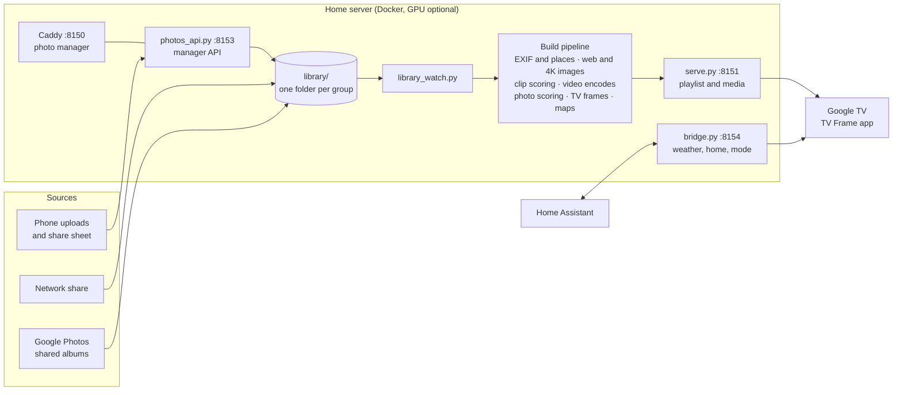

# How TV Frame works

The parts, the build pipeline, the repository layout and how to work on it.

## The parts



- **The TV app** (`android/`) is a Kotlin Android TV app with no dependencies beyond the platform. It runs as the screensaver (a `DreamService`), as an on-demand show, and as the optional home screen. It keeps an offline copy of the stills, so the frame keeps going if the server is down.
- **The server** (`server/`, `tools/`) is plain Python, mostly standard library. It runs in one container (`Dockerfile`, `compose.yaml`) next to a Caddy container for the manager. Photos are scored with [OpenCLIP](https://github.com/mlfoundations/open_clip) ViT-L/14, the LAION aesthetic predictor and the OpenCV YuNet face detector, on the GPU when there is one. Videos and TV frames are encoded with NVENC on NVIDIA cards and with x265, x264 and SVT-AV1 on the CPU otherwise (`server/encoders.py`).
- **The bridge** is the only thing that talks to Home Assistant. The TV asks the bridge, so the Home Assistant token never leaves the server.
- **The photo manager** (`site/index.html`) is a single page with no build step, served read-only by Caddy.

### The build, step by step

A build runs whenever the library changes. Each step only redoes the files that changed, so after the first build most take seconds. The manager's status dot shows the same steps live.

| Step | What happens |
| --- | --- |
| Reading photo info and places | Dates, cameras, lenses and exposure from EXIF; place names for photos with a location. |
| Making web and 4K images | Web-sized images for the manager and 4K copies, from JPEG, HEIC and PNG, in sRGB. |
| Watching videos for the best parts | Each clip is scored second by second for how it looks and how much moves, to find its best stretch. |
| Encoding videos | 4K HEVC for the TV and small previews for the manager. Then each clip's seamless loop and how it was shot. |
| Scoring photos | Aesthetic score, sharpness, exposure, noise and faces for every photo, and near-duplicate groups. |
| Preparing TV frames | Each photo becomes a one-frame 10-bit HEVC video at 3840 x 2160, with the shade for the text baked in. |
| Drawing maps | A small satellite map for each photo with a location. |
| Building the TV playlist | The order, the mix of photos and clips, pairs and trios of tall photos side by side, schedules. |

### A few details worth knowing

- **Why stills are video.** Android TV composites its UI at 1080p, so a normal `ImageView` can never show more than 1080p. Each photo is also encoded as a one-frame HEVC Main 10 video and played on a `SurfaceView`, which the display hardware scales and shows at the panel's native 4K. The screen's text, tiles and fades are drawn on the UI plane above it.
- **Why fades use a veil.** The TV's display hardware does not blend two video layers, so a cross-fade between two video planes turns into a hard cut. Fades go through a brief veil on the UI plane instead, with the next photo's still underneath.
- **Readable text on bright photos.** Bright frames get a graduated shade baked in (like an ND grad filter) under the clock and caption, so white text stays readable without a dark bar.
- **What counts as a duplicate.** Photos taken close together that look alike to the image model are grouped, and only the best of each group goes on the TV. You can pick a different one from the Duplicates page.

## Repository layout

```
tvframe             the command: setup, tv, status, logs, update, uninstall
install.sh          one-line installer (clones, then runs ./tvframe setup)
Dockerfile          the server image: Python, ffmpeg, adb and the scoring models
compose.yaml        the server and the photo manager's web server
android/            the TV app (Kotlin, no third-party libraries) and its build image
server/             playlist server, manager API, bridge, playlist builder, settings loader
tools/              build steps, TV deploy and rollback, watchdog, live data, screenshot tools
curate/             photo scoring and duplicate grouping
site/index.html     the photo manager (one file, no build step)
ingest/             Google Photos shared album sync
caddy/, deploy/     web server config, systemd units for running without Docker
docs/               guide, devices, how it works, running without Docker, releasing, screenshots
.github/workflows/  checks on every push, signed app and images on every release
```

Everything personal stays outside the repository: `~/.config/tvframe/` holds addresses, tokens and Home Assistant entities, and the photos, the library, generated media, scores and logs live in folders that git ignores.

## Development

- **Checks.** Every push runs [`.github/workflows/ci.yml`](../.github/workflows/ci.yml): the Python compiles, `shellcheck` passes on every script, the CPU encoders produce the same 10-bit HEVC as NVENC, and the TV app builds. Run the same locally with `python3 -m compileall -q server tools curate ingest` and `shellcheck -S warning tvframe install.sh tools/env.sh tools/conf.sh tools/deploy.sh tools/rollback.sh curate/run.sh server/compat8.sh`.
- **A test install next to a real one.** In a second checkout, put `COMPOSE_PROJECT_NAME=tvframe-test` and `TVFRAME_PORT_WEB=9150`, `TVFRAME_PORT_MEDIA=9151`, `TVFRAME_PORT_API=9153`, `TVFRAME_PORT_BRIDGE=9154` in `.env`, and `TVFRAME_CONFIG_DIR=$PWD/.home/.config/tvframe ./tvframe setup`.
- **The TV app** builds with `./gradlew assembleRelease` in `android/` (JDK 17, Android SDK 34), or in the `android/Dockerfile` image as `./tvframe tv` does. `-Ptvframe.server=http://<server>` sets the default server; `adb shell am start -n app.tvframe/.SettingsActivity --es server http://<server> --ez close true` changes it on an installed app.
- **Screenshots.** The manager shots come from a test install filled with stock photos: `OFFSET=1000 node tools/screenshots/install_shots.js docs/screenshots` (needs `puppeteer-core` and Chrome). The setup shot is a real run, recorded with `script` and drawn with `tools/screenshots/terminal_shot.py`. The TV shots come from an Android TV emulator showing a stock library from `make_demo.py`, served by `demo_server.py` (made-up weather, no internet), through `adb reverse tcp:8151 tcp:9151` and `adb reverse tcp:8154 tcp:9154`, captured with `adb exec-out screencap -p`. Never use a real library.
- **Releasing.** [docs/RELEASING.md](RELEASING.md): signing, tags, published images, and the checklist for making the repository public.
