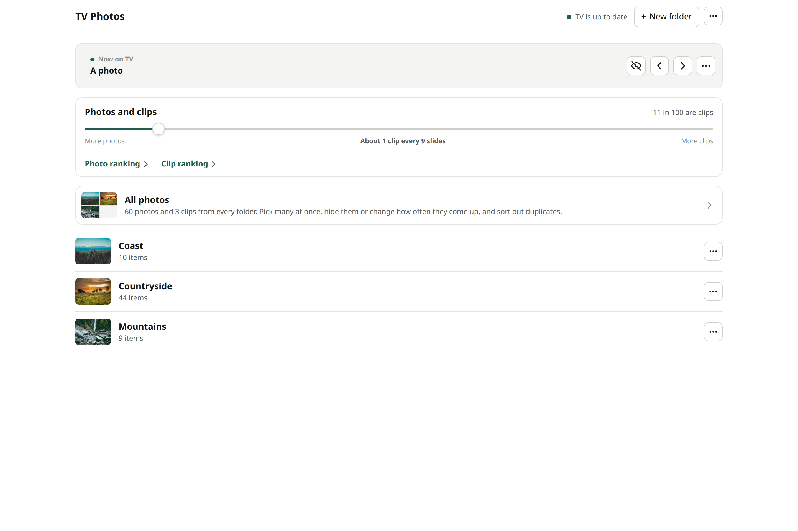
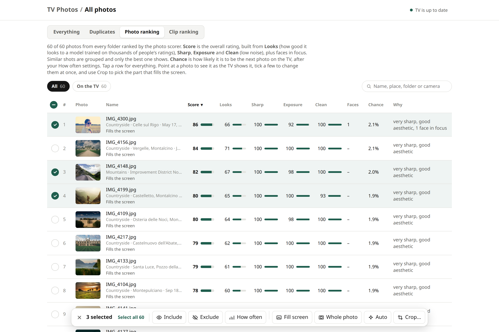
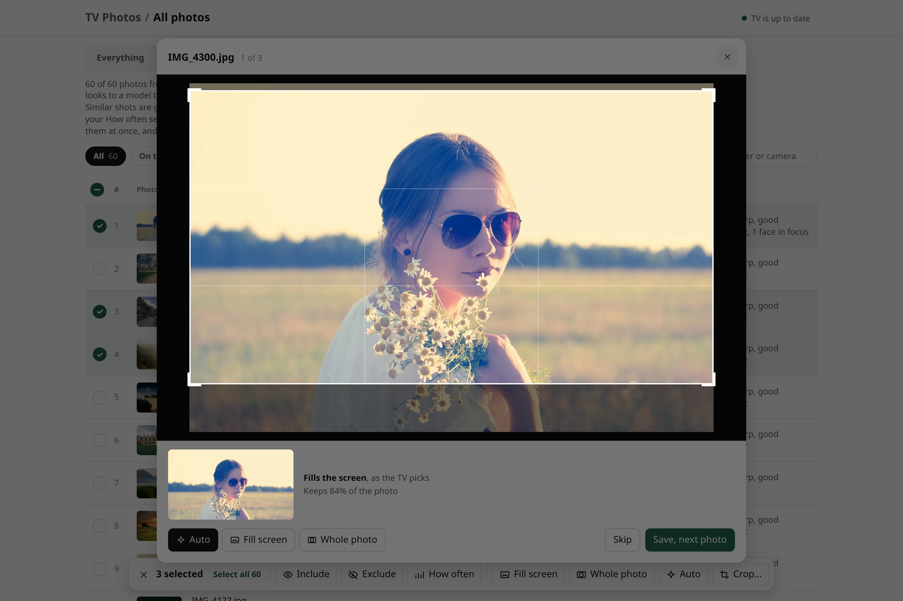
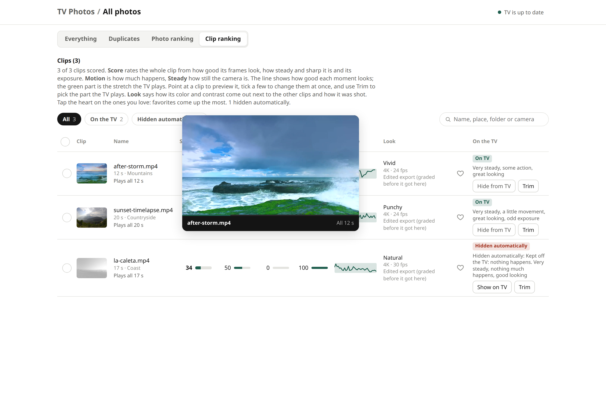
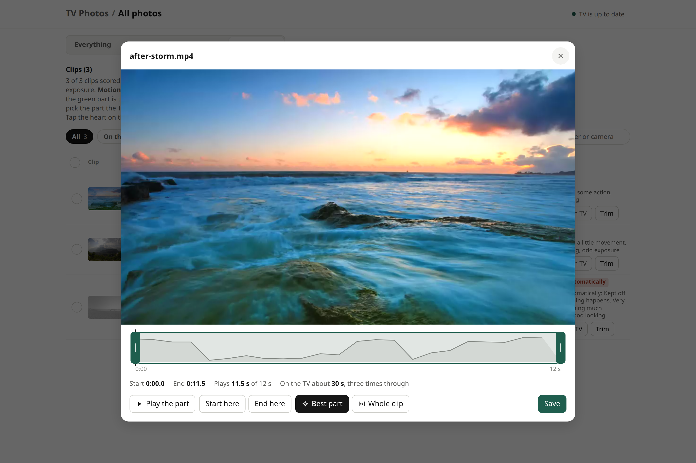
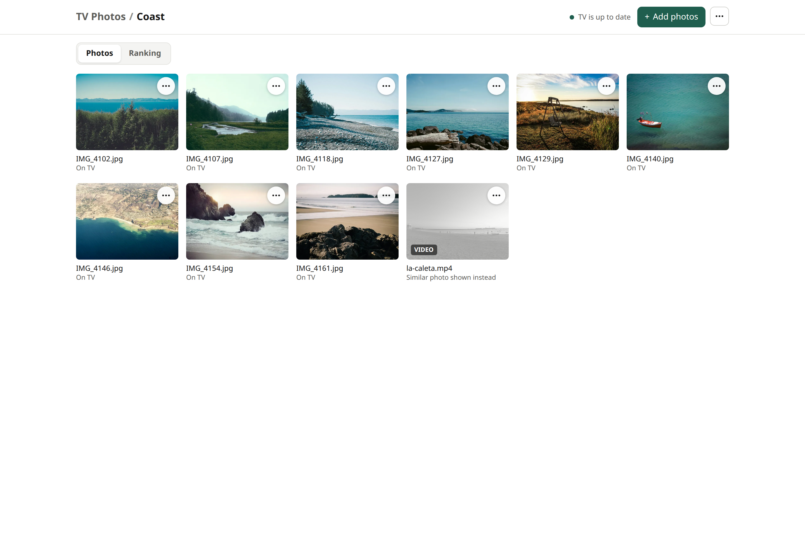
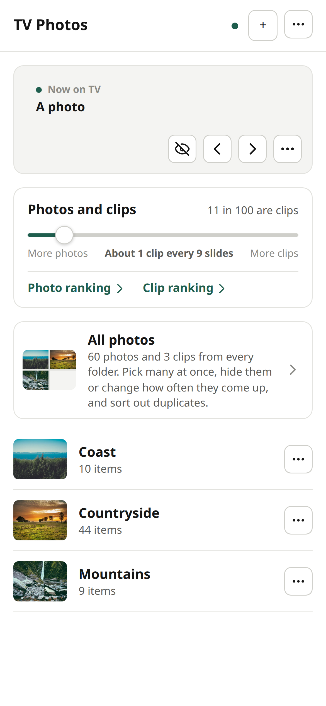

# Using TV Frame

Everything after the install: the TV, the photo manager, settings, extras and fixes. Installing is in the [README](../README.md#install).

- [Using it](#using-it)
- [Settings](#settings)
- [Optional extras](#optional-extras)
- [What leaves your network](#what-leaves-your-network)
- [Troubleshooting](#troubleshooting)

## Using it

### Day to day

| To | Do this |
| --- | --- |
| Add photos | Drop them into a folder inside your photos folder, or upload on the photo manager. A new folder is a new group on the TV. A build starts 45 seconds after the last file lands, and the TV picks up the result within 30 minutes. |
| Hide something | Tap the hide button on Now on TV, or open the photo's menu on the manager and choose Hide from TV. Hidden photos stay in your folder. |
| See more of something | Photo menu, then See more often, or the heart on Now on TV for a favorite. |
| See a photo's details | Press OK on the remote. Press OK again, or wait, to close. |
| Skip ahead or go back | The arrows on the manager's Now on TV card. |
| Change how many clips play | Move the Photos and clips slider on the manager's home page. |
| Show a folder only part of the year | Folder menu, then Schedule. |
| Check the build | The status dot at the top of the manager: tap it for each step and the GPU load. Or `./tvframe status`. |
| Rebuild now | `./tvframe rebuild` |
| See what the server is doing | `./tvframe logs` |
| Change a setting | Edit `~/.config/tvframe/config.env`, then `./tvframe restart`. See [Settings](#settings). |
| Update TV Frame | `./tvframe update`: pulls the new version, rebuilds the server and updates the app on the TV. |
| Undo everything on the TV | `./tvframe tv remove` (add `--uninstall` to remove the app too) |
| Remove TV Frame | `./tvframe uninstall`. Your photos and settings are left where they are. |

### On the TV

- **When it starts.** TV Frame is the TV's screensaver, so Glance comes up after 5 idle minutes. **OK** opens the details; any other button brings back what you were watching.
- **The details panel** for the photo on screen: where and when, camera and lens, exposure, and a small satellite map when the photo has a location. **OK** or **Back** closes it.
- **The quiet home screen** (if you chose it) opens on **Home**. Arrow keys move between apps, **OK** opens one. The Google TV home is still installed and comes back with `./tvframe tv remove`.
- **Offline.** The app keeps a copy of the stills on the TV. If the server is off, the frame keeps showing what it has.

### The photo manager, page by page

| Page | What it is for |
| --- | --- |
| **Home** | Now on TV (skip, go back, favorite, hide), the photos and clips slider, and your folders with how many of each are on the TV. |
| **A folder** | Every photo and clip in it with its state on the TV. Upload by dragging files onto the page. Rename, schedule or remove the folder from its menu. |
| **Everything** | All folders in one grid, with search. Hover to preview. |
| **Duplicates** | Groups of near-identical photos. The best one shows on the TV; pick another if you prefer. |
| **Photo ranking** | Every photo's score and what goes into it, sortable. Select many to hide, show or change how often they come up. Each photo's TV framing: fill the screen, whole on a blurred copy of itself, your own crop, or left to the TV. |
| **Clip ranking** | Every clip with what the scorer saw in it. Hover to preview, select many to include or leave out, and trim the part the TV plays. |

<picture>
  <source media="(prefers-color-scheme: dark)" srcset="screenshots/manager-home-dark.png">
  
</picture>

<table>
  <tr>
    <td width="50%">
      <picture>
        <source media="(prefers-color-scheme: dark)" srcset="screenshots/manager-rank-dark.png">
        
      </picture>
      
Photo ranking, three photos selected

    </td>
    <td width="50%">
      <picture>
        <source media="(prefers-color-scheme: dark)" srcset="screenshots/manager-frame-dark.png">
        
      </picture>
      
How a photo is framed on the TV

    </td>
  </tr>
  <tr>
    <td>
      <picture>
        <source media="(prefers-color-scheme: dark)" srcset="screenshots/manager-clips-dark.png">
        
      </picture>
      
Clip ranking, previewing a clip on hover

    </td>
    <td>
      <picture>
        <source media="(prefers-color-scheme: dark)" srcset="screenshots/manager-trim-dark.png">
        
      </picture>
      
Trimming the part of a clip the TV plays

    </td>
  </tr>
  <tr>
    <td>
      <picture>
        <source media="(prefers-color-scheme: dark)" srcset="screenshots/manager-folder-dark.png">
        
      </picture>
      
A folder

    </td>
    <td>
      

      <picture>
        <source media="(prefers-color-scheme: dark)" srcset="screenshots/phone-dark.png">
        
      </picture>
      

      
On a phone

    </td>
  </tr>
</table>

Changes on the manager reach the TV within seconds (hiding, favorites, skipping) or after the next build (framing, trims, new photos).

## Settings

Everything lives in `~/.config/tvframe/config.env`, written by `setup` and safe to edit. Run `./tvframe restart` after a change. [`config.example.env`](../config.example.env) has every setting with a comment.

| Setting | What it does |
| --- | --- |
| `TVFRAME_HOST` | This computer's address on your network, as the TV and your phone reach it. |
| `TVFRAME_TV` | The TV's address for installing and the watchdog, such as `192.168.1.30:5555`. Set by `./tvframe tv`. |
| `TVFRAME_TZ` | Time zone for the clock, schedules and logs, such as `America/New_York`. |
| `LIVE_LAT`, `LIVE_LON`, `LIVE_PLACE` | Where the weather, air quality and sun times are for, and the name shown. Leave them out to turn the weather off. |
| `HOME_LAT`, `HOME_LON` | Photos further than about 40 km from here count as trips. Defaults to the weather location. |
| `TVFRAME_QUIET_HOME` | `1` for the quiet home screen, `0` to leave the Google TV home alone. Set by `./tvframe tv`. |
| `TVFRAME_ENCODER` | `auto` (the default: NVENC when it works, else the CPU), `nvenc` or `cpu`. |
| `HA_URL`, `HA_TOKEN_FILE`, `HA_ENTITIES`, `HA_NOTIFY` | Home Assistant, all optional. See below. |

Two more files sit next to the checkout and are written by `setup`: `.env` (the folders Docker mounts, your user id, which image to use) and, with an NVIDIA card, `compose.override.yaml`.

## Optional extras

- **Home Assistant.** Put a long-lived access token in `~/.config/tvframe/ha_token` (chmod 600), set `HA_URL`, and copy [`home_entities.example.json`](../home_entities.example.json) to `~/.config/tvframe/home_entities.json` with your own entities. Glance then shows the inside temperature and humidity and the laundry while it runs, the quiet home screen shows what your speakers are playing, and the watchdog sends a phone notification when it had to fix the TV. The token never leaves the server: the TV only talks to TV Frame's bridge.
- **Google Photos shared albums.** [`ingest/README.md`](../ingest/README.md) pulls shared albums into folders on a schedule.
- **iPhone uploads.** The manager's menu has Send photos from iPhone: a share sheet shortcut that uploads straight into a folder.
- **Sony S-Log3 video.** Put Sony's S-Log3 (S-Gamut3.Cine) to Rec.709 LUT, as a 33-point `.cube` file, at `tools/slog3_709.cube` and ungraded clips get it applied. Without it they play as shot.

## What leaves your network

TV Frame runs at home and needs no account. It reaches out to these free services, none of which get your photos:

| Service | For | Sent |
| --- | --- | --- |
| [Open-Meteo](https://open-meteo.com) | Weather, air quality, the town lookup during setup | The weather location |
| [NPR](https://www.npr.org) top stories RSS | The headline tile | Nothing |
| [OpenStreetMap](https://www.openstreetmap.org) Nominatim and Overpass | Place names for photos with a location | Each photo's location, rounded to about 100 m |
| [Esri World Imagery](https://www.arcgis.com/home/item.html?id=10df2279f9684e4a9f6a7f08febac2a9) | The small satellite maps in the details panel | The map area around each photo |

Photos without a location never cause a lookup. Results are cached, so each place is looked up once.

## Troubleshooting

| Problem | What to do |
| --- | --- |
| `./tvframe tv` cannot reach the TV | Check USB debugging is still on (some updates turn it off) and the address is right. Devices that use Wireless debugging get a new port after every restart: run `./tvframe tv` again and pair. |
| The TV asked to allow debugging and nothing happened | It waits two minutes. Run `./tvframe tv` again and choose Allow with Always allow ticked. |
| The TV went back to its own screensaver | A system update can reset it. The watchdog puts it back within 5 minutes when `TVFRAME_TV` is set; `./tvframe tv` does it straight away. |
| New photos are not on the TV | Look at the status dot on the manager, or `./tvframe status`. A build runs 45 seconds after the last change; the TV checks for a new playlist every 30 minutes. |
| A build failed | Tap the status dot for the step that failed, and `./tvframe logs` for the reason. It retries every 10 minutes. |
| `OpenEncodeSessionEx failed: incompatible client key` | The graphics card ran out of video encoder sessions, usually because something else (Plex, Jellyfin, a game recorder) is encoding at the same time. The build retries on its own. |
| `./tvframe status` says `encoder: cpu` on a computer with an NVIDIA card | Docker cannot reach the card. Run `./tvframe setup` again; it checks the card and offers to install the NVIDIA Container Toolkit. |
| The weather tile is missing | Set `LIVE_LAT`, `LIVE_LON` and `LIVE_PLACE`, then `./tvframe restart`. |
| Port 8150, 8151, 8153 or 8154 is taken | Something else on the computer uses it. The TV app and the manager expect these ports, so free them. |
